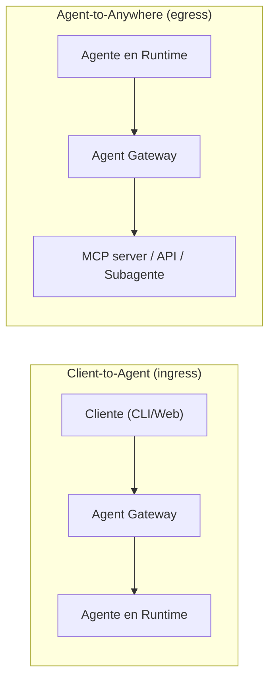

# Lab 4 — Gobierno runtime: Identity + Registry + Gateway + Policies

**Objetivo:** entender y montar el **punto de enforcement** del tráfico agéntico, y cómo se combinan
identidad, catálogo y políticas para gobernar a un agente en producción.
**Tiempo:** ~15 min (demostración guiada; el montaje completo es infra-dependiente).

---

## Idea central

> El gobierno de agentes no es un checkbox de IAM. Google lo modela como **5 componentes que trabajan
> juntos**. Juntos responden 5 preguntas:

| Componente | Pregunta que responde |
|---|---|
| **Agent Identity** | ¿**Quién** hizo la request? (SPIFFE ID por agente) |
| **Agent Registry** | ¿**Qué** destinos están aprobados? (allowlist) |
| **Policies (IAM + Semantic)** | ¿**Qué acciones** están permitidas? |
| **Agent Gateway** | ¿**Dónde** se aplican las políticas? (enforcement) |
| **Observability** | ¿**Qué pasó** realmente? (traces/logs) |

Y Model Armor es la capa de contenido que se engancha al Gateway (input y output).

---

## Los dos modos del Agent Gateway



| Capa de gobierno | Ingress | Egress |
|---|---|---|
| **Identidad** | Identidad del cliente/usuario | Identidad del agente (SPIFFE) |
| **Agent Registry** | No aplica | Sí (destinos de salida) |
| **IAM Unified Access Policy + PAB** | No aplica | Sí (por identidad del agente) |
| **Model Armor** | Inspecciona prompt entrante | Inspecciona payload saliente |
| **Semantic Governance** | Evalúa constraints en request entrante | Evalúa constraints en tool calls |

---

## Paso 1 — Ejecutar el script de gobierno

El script **ejecuta directamente** los comandos. Es **idempotente** (no recrea lo que ya existe), así
que puedes correrlo sin miedo:

```bash
cd labs/lab-04-gobierno-gateway
./governance_setup.sh   # lee ../lab-00-setup/.env automáticamente
```

Ejecuta, en orden: **(1) Identity → (2) Registry → (3) Gateway**. Si un grupo de comandos `gcloud`
cambió de nombre (por el rebrand), te avisa en vez de fallar.

**Checkpoint ✅:** obtienes la `effectiveIdentity` del agente (un `principal://…`) y se crean los
recursos de Registry/Gateway.

> ⚠️ Los pasos que dependen de tu red (VPC, Private Service Connect, certificados, adjuntar
> políticas/Model Armor al gateway) se listan al final del script como "siguientes pasos": esos sí
> varían por organización y hay que configurarlos siguiendo la doc.

## Paso 2 — Bloquear por defecto (la clave del modelo mental)

Entiende esto: en egress, **por defecto todo está bloqueado** salvo que exista una política que
ligue la identidad del agente al destino. Esto invierte el modelo mental de "todo permitido":

```
Sin política  →  DENY
Con política  →  ALLOW (solo a lo registrado y permitido)
```

Esto es lo que hace que un agente no pueda, aunque "quiera", llamar a un MCP no aprobado.

## Paso 3 — Políticas: determinista vs semántica

- **IAM Unified Access Policy / Principal Access Boundary (PAB)**: acceso determinista por identidad
  y recurso. Es tu línea base de least privilege.
- **Semantic Governance Policies (NLC)**: reglas de negocio en **lenguaje natural**, evaluadas en
  runtime. Ejemplos:
  - "El agente no puede ejecutar una devolución y un cambio de dirección en el mismo flujo."
  - "No compartir datos de clientes de la región EU con herramientas externas."
  - "Las skills de administración solo pueden invocarse por agentes del dominio `ops`."

> ⚠️ En el mismo gateway de ingress, **Model Armor y Semantic Governance no se combinan**: elige uno
> como policy de entrada (guardrails de contenido vs reglas semánticas).

## Paso 4 — Verificar el gobierno en las trazas

En la consola: **Agent Platform → Govern → Agent Gateway → Monitor**, y las trazas en
**Optimize → Observability**. Deberías ver las llamadas egress con su veredicto de política.

Además, activa **Agent Anomaly Detection** (preview): lee los logs y trazas OTel que tu agente ya
emite y marca desviaciones (uso indebido de tools, loops, abuso de privilegios).

---

## Casos de estudio para discusión

1. **MCP prompt injection**: un MCP server malicioso devuelve un "tool description" con instrucciones
   inyectadas. ¿Quién lo detiene? → Model Armor en egress + Registry (solo MCP aprobados).
2. **Agente con privilegio excesivo**: migra de service account del proyecto a Agent Identity con PAB.
3. **Skill peligrosa**: una skill de borrado marcada para dominio `ops` → Semantic Governance la
   limita por contexto.

---

## Limpieza (opcional)

Al terminar, borra los recursos para no dejar cargos. Desde la raíz del repo:

```bash
./teardown.sh   # lee labs/lab-00-setup/.env automáticamente
```

Borra el agente (o agentes) de Agent Runtime, el template de Model Armor, el Agent Gateway y los
registros de Agent Registry. (Opción: `REMOVE_BUCKET=1` para borrar también el bucket de staging.)

---

## Troubleshooting

| Síntoma | Causa | Solución |
|---|---|---|
| Egress siempre `403` | Falta IAM policy ligando identidad → destino | Crea la Unified Access Policy correcta. |
| `503` en el gateway | Red con Network Security Integration / NGFW Enterprise | No soportado; cambia de red. |
| El gateway no ve tráfico | Agente no ruteado por el gateway | Revisa "Route Agent Runtime traffic through Agent Gateway". |
| >5000 recursos | Límite por instancia de gateway | Divide gateways por dominio. |

---

## 🎓 Cierre del workshop

Ya tienes el ciclo completo: **construiste** el agente (Lab 1), lo **blindaste** (Lab 2), lo
**evaluaste** (Lab 3) y lo **gobernaste** (Lab 4). Ese es el loop que separa un demo de un agente
de producción.

Vuelve a `docs/00-documento-maestro.md` §11 para los takeaways y `recursos/bibliografia.md` para seguir.
